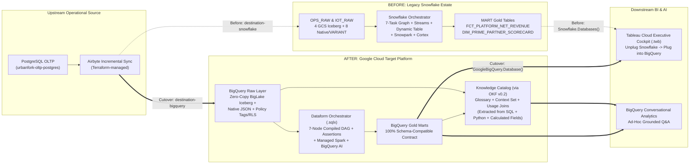
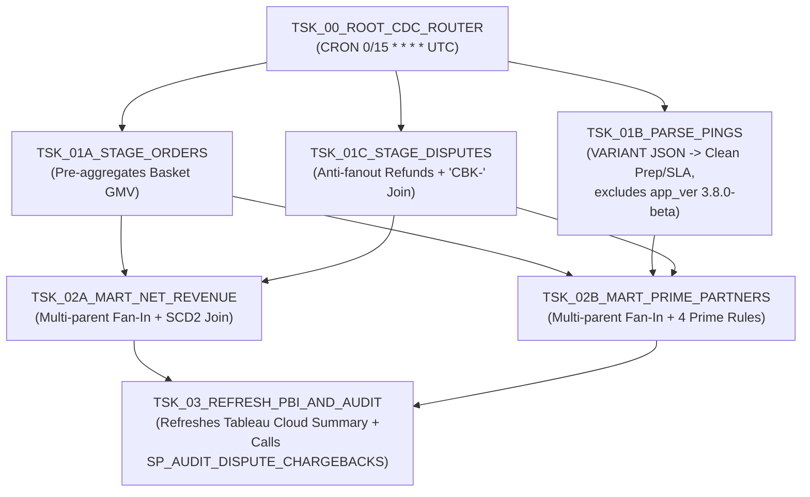

# End-to-End Demo Specification: Seamless Snowflake-to-GCP Stack Migration with Antigravity
## Scenario: "UrbanFork" — On-Demand Food & Grocery Delivery (45-Minute Live Cutover)

> [!IMPORTANT]
> **Core Demo Thesis ("End-to-End Seamless Cutover: Airbyte -> Warehouse & Orchestration -> Knowledge Catalog -> Tableau Cloud")**
> Real enterprise migrations don't happen in a vacuum: Snowflake sits between upstream **ingestion pipelines (Airbyte)**, an internal **orchestrator (Snowflake Task Graphs & Dynamic Tables)**, and downstream **BI reports (Tableau Cloud)**.
> In **45 minutes**, this live demo starts from a running **PostgreSQL -> Airbyte -> Snowflake (`URBANFORK_PROD`, Hybrid Iceberg + FDN) -> Tableau Cloud** stack and shows **Antigravity (AGY)** orchestrating a **zero-downtime, end-to-end cutover to Google Cloud**:
> 1. **Seamless Ingestion & Hybrid Data Cutover**: Zero-Copy **BigLake Iceberg** mount for large fact tables + Parquet/`JSON` unload for native `VARIANT` tables, followed by **live Airbyte destination re-pointing** (`destination-snowflake` -> `destination-bigquery`) preserving incremental cursors without dropping a single live order.
> 2. **Orchestrator Migration (Snowflake 7-Task DAG -> BigQuery Dataform DAG)**: Full conversion of a 4-tier, **7-node Snowflake Task Graph** (`AFTER` fan-out/fan-in dependencies, CDC `STREAMS`, `DYNAMIC TABLE`, and Scripting Stored Procedure), **Snowpark Python**, and **Cortex AI** into a Git-versioned **Dataform** DAG (`.sqlx` + assertions + Workflow schedule), **Managed Spark**, and **BigQuery AI (TimesFM / Gemini)** with 100% mathematical parity.
> 3. **Business Logic Rescue ("Knowledge-as-Code")**: Reverse-engineering undocumented KPI formulas, status flags, and join traps out of **Snowflake SQL, Snowpark Python, AND Tableau Calculated Fields (`.twb`)** into **Open Knowledge Format (OKF v0.2)** -> **BigQuery Metadata**, **Knowledge Catalog** (Business Glossary + Context Sets + Usage-Based Data Insights), and **BigQuery Conversational Analytics**.
> 4. **Seamless Tableau Cloud Cutover**: Unplugging the **Tableau Cloud Workbooks (`.twb`)** from `Snowflake.Databases(...)` and plugging it directly into `GoogleBigQuery.Database(...)`—refreshing the exact same executive visuals with **zero broken Calculated Fields or charts**.

---

## 1. 45-Minute Live Demo Run-of-Show

| Time | Act | Live Action Driven by Antigravity | Stack Components Shown |
| :--- | :--- | :--- | :--- |
| **00:00 – 05:00** *(5 min)* | **Act 1: Tour of the Live Legacy Stack & Audit** | Show the active legacy stack: **Airbyte** syncing OLTP Postgres -> **Snowflake (`URBANFORK_PROD`)**, the **7-Node Task Graph** in Snowsight, and the live **Tableau Cloud Executive Cockpit**. Antigravity audits the entire pipeline end-to-end. | Airbyte, Snowflake Task Graph, Tableau Cloud, Antigravity |
| **05:00 – 13:00** *(8 min)* | **Act 2: Hybrid Data Migration & Seamless Airbyte Cutover** | 1. Mounts **4 GCS Iceberg tables Zero-Copy** in BigQuery BigLake (< 5s) and migrates **8 Native/`VARIANT` tables** to BigQuery (`JSON` + Policy Tags), starting the background Knowledge Catalog scan.<br>2. Rewrites `ingestion-airbyte/airbyte_terraform/main.tf` from `destination-snowflake` to `destination-bigquery`, injects **50 live OLTP orders**, runs Airbyte sync, and shows incremental orders landing seamlessly in BigQuery! | BigLake Iceberg, BigQuery Storage, Airbyte (`Postgres -> BQ`), Policy Tags |
| **13:00 – 26:00** *(13 min)* | **Act 3: Snowflake Task Graph -> Dataform DAG (+ Spark & BQ AI)** | 1. **Orchestrator Focus (8 min)**: Converts the **7-node Snowflake Task DAG** (`TSK_00` -> `TSK_01A/B/C` -> `TSK_02A/B` -> `TSK_03`) + `DYNAMIC TABLE` into a **Dataform** DAG (`declarations/`, `staging/`, `marts/`, `operations/`, `assertions/`). Visually compare Snowsight's Task Graph with BigQuery Studio's **Dataform Compiled Graph**, run `dataform run`, and verify 100.00% cent-level parity!<br>2. **Spark & AI (5 min)**: Converts Snowpark fraud scoring to Dataproc Serverless PySpark and Cortex `CLASSIFY_TEXT` / `ML.FORECAST` to zero-shot BigQuery `AI.CLASSIFY` / `AI.FORECAST` (TimesFM). | Dataform DAG & Workflow Config, Managed Spark, BigQuery AI |
| **26:00 – 37:00** *(11 min)* | **Act 4: Business Logic (SQL + Python + Calculated Fields) -> OKF -> Knowledge Catalog** | Antigravity extracts undocumented KPI formulas, status codes, and join caveats from **Snowflake SQL, Snowpark UDFs, AND Tableau `.twb` Calculated Fields** into **OKF v0.2** (`bundle/` & `okf/`). Publishes descriptions to BigQuery, populates **Knowledge Catalog Business Glossary** (`entryLinks`) & **Context Set**, and seeds `QUERY_HISTORY` for **Usage-Based Data Insights**. | Open Knowledge Format (OKF), Knowledge Catalog (Glossary, Context Set, Data Insights) |
| **37:00 – 45:00** *(8 min)* | **Act 5: Tableau Cloud Cutover & Conversational Analytics** | 1. **Tableau Cloud Cutover (4 min)**: Antigravity updates Power Query M partitions in `bi-tableau/*.tmdl` from `Snowflake.Databases(...)` to `GoogleBigQuery.Database([UseStorageApi=true])`. Refresh Tableau Cloud -> **zero broken visuals, exact `$153,150.49` Q3 benchmark + the 50 new live Airbyte orders**, and shut down Snowflake!<br>2. **BigQuery Conversational Analytics (4 min)**: Live ad-hoc executive Q&A grounded in Knowledge Catalog (navigating SCD2, Snapshot Trap, and PII masking). | Tableau Cloud (`.twb` on BigQuery), BigQuery Conversational Analytics |

---

## 2. End-to-End Architecture & Repository Structure

### 2.1 Before vs. After Architecture (Seamless Re-Pointing)



### 2.2 Workspace Layout (`/Users/lvaracca/Development/snowflake-demo`)

```text
snowflake-demo/
├── SPECIFICATION.md                          # Master English specification
├── README.md                                 # 5-minute setup & run guide
├── agent-config.json                         # GCP & Snowflake environment config
├── .env.example                              # Credentials template
├── ingestion-airbyte/                        # Upstream OLTP + Airbyte Seamless Cutover
│   ├── docker-compose.oltp.yml               # Lightweight Postgres 16 OLTP source (logical WAL)
│   ├── init_oltp.sql                         # Operational tables aligned with 2026-03-31 cutoff
│   ├── simulate_live_orders.py               # Injects +50 live orders during Act 2 cutover
│   └── airbyte_terraform/                    # Declarative Airbyte config (Snowflake -> BigQuery)
│       ├── main.tf
│       └── variables.tf
├── data-generator/                           # Deterministic Synthetic Data & Snowflake Seeder
│   ├── generate_urbanfork_data.py            # Generates 624,924 rows (seed=42) + ground_truth_manifest.json
│   ├── seed_snowflake_instance.py            # 2-step provisioner for Snowflake 30-day Enterprise Trial
│   └── output/                               # Generated .csv.gz, .jsonl.gz & ground_truth_manifest.json
├── snowflake-source/                         # Complete Legacy Snowflake Codebase
│   ├── 00_external_volume_and_integration.sql
│   ├── 01_ddl_hybrid_iceberg_and_fdn.sql     # 4 GCS Iceberg tables + 8 Native FDN/VARIANT tables
│   ├── 02_load_and_snowpipe.sql              # Bulk COPY INTO + Snowpipe definition
│   ├── 03_streams_tasks_dynamic_tables.sql   # 7-Node Snowflake Task DAG + Streams + Dynamic Table
│   ├── 04_legacy_views_and_procs.sql         # Complex Views (FLATTEN, QUALIFY, ASOF JOIN) + Scripting Proc
│   ├── 05_cortex_ai_and_ml.sql               # Cortex CLASSIFY_TEXT, SENTIMENT & ML.FORECAST
│   ├── 06_governance_policies.sql            # Object Tags, Dynamic Data Masking & Row Access Policy
│   ├── 07_workload_query_history.sql         # Analyst queries populating QUERY_HISTORY
│   ├── snowpark/snowpark_merchant_fraud_scoring.py
│   └── cortex-analyst/cortex_ops_model.yaml
├── bi-tableau/                               # Downstream Tableau Cloud Project (.pbip / TMDL in Git!)
│   ├── UrbanFork_Executive_Cockpit.pbip
│   ├── UrbanFork_Executive_Cockpit.SemanticModel/
│   │   └── definition/
│   │       ├── model.tmdl
│   │       ├── expressions.tmdl              # SnowflakeHost / Warehouse parameters -> BigQuery
│   │       └── tables/*.tmdl                 # M-Query partitions + 11 Calculated Fields Measures
│   └── UrbanFork_Executive_Cockpit.Report/
│       ├── definition.pbir
│       └── report.json
├── gcp-target/                               # Populated live by Antigravity (Dataform, Spark, BQ AI, RLS/CLS)
├── okf/ & bundle/                            # Extracted Open Knowledge Format v0.2 repository
└── scripts/01_setup_gcp_prereqs.sh           # GCS Lakehouse bucket & BigLake connection setup
```

---

## 3. Data Model & Hybrid Storage Mix (624,924 Verified Rows)

| # | Snowflake Table | Storage Format | Key Columns | BigQuery Target Strategy | Verified Rows & Analytical Trap |
| :--- | :--- | :--- | :--- | :--- | :--- |
| **1** | `OPS_RAW.DLV_ORD_HDR` | **Iceberg (`GCS`)** + `STREAM` | `ORD_ID`, `ORD_DT_SK`, `ORD_TS`, `USR_ID`, `MRC_ID`, `CRR_ID`, `ZONE_ID`, `VERT_CD`, `ORD_STS_CD`, fees/pay/vouchers | **Zero-Copy BigLake Iceberg** + Incremental Airbyte | **90,000** (+50 live via Airbyte). |
| **2** | `OPS_RAW.DLV_ORD_ITEM_LN` | **Iceberg (`GCS`)** | `ORD_LN_ID`, `ORD_ID`, `ITEM_SKU`, `ITEM_NM`, `QTY_N`, `UNIT_PRC_USD` | **Zero-Copy BigLake Iceberg** + Incremental Airbyte | **277,146**. Basket GMV lines. |
| **3** | `OPS_RAW.ZNE_FLEET_SNAP` | **Iceberg (`GCS`)** | `SNAP_TS`, `ZONE_ID`, `ONLINE_CRR_N`, `BUSY_CRR_N`, `UNASSIGNED_ORD_N` | **Zero-Copy BigLake Iceberg** | **60,372**. **Trap #3 (Snapshot Trap)**: London latest=`95` vs naive sum=`76,734`! |
| **4** | `OPS_RAW.MRC_PAYOUT_LEDGER` | **Iceberg (`GCS`)** | `LEDGER_ID`, `REF_DOC_TXT`, `MRC_ID`, `ISSUE_DT`, `PAID_DT`, `LEDGER_AMT_USD`, `PYT_STS_FLG` | **Zero-Copy BigLake Iceberg** | **13,746**. **Trap #4 (`'CBK-' \|\| ORD_ID` Concat)**. |
| **5** | `IOT_RAW.APP_DELIVERY_PINGS` | **Native FDN (`VARIANT`)** + `PIPE` | `PING_ID`, `INGEST_TS`, `ORD_ID`, `PAYLOAD` (`VARIANT`) | Unload -> **BigQuery Native `JSON`** | **142,285**. Nested JSON + `1,933` `3.8.0-beta` GPS bug orders. |
| **6** | `OPS_RAW.CUST_USER_MSTR` | **Native FDN** + Masking | `USR_ID`, `F_NM`, `L_NM`, `EMAIL_TXT`, `PHONE_TXT`, `SIGNUP_DT`, `HOME_ZONE_ID`, `UF_PASS_FLG` | **BigQuery Native + Policy Tags (CLS)** | **30,000** (includes `45` planted serial refund abusers). |
| **7** | `OPS_RAW.CRR_COURIER_MSTR` | **Native FDN** + Masking | `CRR_ID`, `CRR_FULL_NM`, `PHONE_TXT`, `VEH_TP_CD`, `HOME_ZONE_ID`, `ACTIVE_FLG` | **BigQuery Native + Policy Tags (CLS)** | **2,500**. |
| **8** | `OPS_RAW.GEO_ZONE_LKP` | **Native FDN** + RLS | `ZONE_ID`, `CITY_NM`, `CNTRY_CD`, `REG_CD`, `SLA_TARGET_MIN` | **BigQuery Native + Row Access Policy** | **36** zones across 12 global cities. |
| **9** | `OPS_RAW.MRC_PARTNER_MSTR` | **Native FDN** | `MRC_ID`, `MRC_NM`, `VERT_CD`, `CUISINE_CAT`, `ZONE_ID`, `ONBOARD_DT`, `ACTIVE_FLG` | **BigQuery Native** (`CLUSTER BY ZONE_ID, VERT_CD`) | **400** merchants (300 restaurants, 100 dark-stores). |
| **10** | `OPS_RAW.MRC_COMM_SCD2` | **Native FDN** | `MRC_ID`, `EFF_FROM_DT`, `EFF_TO_DT`, `COMM_RATE_PCT`, `PKG_FEE_USD`, `IS_CURR_FLG` | **BigQuery Native** (`PARTITION BY EFF_FROM_DT`) | **1,100**. **Trap #1 (SCD2)**: Q3 2025 Restaurant true Net Rev = `$153,150.49` vs naive = `$280,447.29`! |
| **11** | `OPS_RAW.DSP_REFUND_FCT` | **Native FDN** + Cortex | `DSP_ID`, `ORD_ID`, `DSP_TS`, `RFND_AMT_USD`, `RFND_STS_FLG`, `DSP_RSN_CD`, `CUST_TICKET_TXT` | **BigQuery Native** + `AI.CLASSIFY` / `AI.SCORE` | **6,243**. **Trap #2 (Fan-out)**: True refunds = `$248,632.85` vs naive join = `$813,512.14`! |
| **12** | `OPS_RAW.SYS_CAL_DIM` | **Native FDN** | `DT_SK`, `CAL_DT`, `ISO_WK_N`, `FISC_YR_N`, `FISC_QTR_N`, `IS_PEAK_HOLIDAY` | **BigQuery Native** | **1,096** (Fiscal Year starts Feb 1). |

---

## 4. Deep Dive on the Three New End-to-End Highlights

### 4.1 Seamless Ingestion Cutover with Airbyte (`ingestion-airbyte/`)
- **Pre-Migration State**: `airbyte_terraform/main.tf` defines `airbyte_source_postgres.urbanfork_oltp` syncing `dlv_ord_hdr`, `dlv_ord_item_ln`, and `dsp_refund_fct` in `incremental_deduped_history` mode (`cursor_field = ["updated_at"]`) into `airbyte_destination_snowflake.snowflake_ops_raw`.
- **Live Cutover with Antigravity**:
  1. Antigravity inspects `main.tf`, adds `airbyte_destination_bigquery` (configured with GCS staging on `gs://<project>-urbanfork-lakehouse/airbyte-staging` in `us-central1`), and updates `airbyte_connection.urbanfork_oltp_incremental` to target BigQuery while retaining stream cursor watermarks (`2026-03-31 23:58:00`).
  2. You run `python3 ingestion-airbyte/simulate_live_orders.py --count 50` to inject 50 live April 1st orders (`ORD-0090001`..`ORD-0090050`) into Postgres, trigger Airbyte sync, and watch those exact 50 incremental orders flow into BigQuery -> Dataform -> Tableau Cloud with **zero downtime and zero duplicate historical reload**.

### 4.2 Orchestrator Migration: 7-Node Snowflake Task DAG -> Dataform DAG (`03_streams_tasks...`)



- **Why this resonates with Data Engineers**: Snowflake Task Graphs lock orchestration logic inside imperative DDL (`AFTER parent1, parent2`, `WAREHOUSE = ...`, no built-in data quality assertions, opaque Git diffs).
- **What Antigravity generates in `gcp-target/dataform/`**:
  - `definitions/sources/*.sqlx` (`type: "declaration"` pointing to the BigLake Iceberg & Native raw tables),
  - `definitions/staging/stg_order_baskets.sqlx`, `stg_clean_delivery_pings.sqlx`, `stg_order_disputes_agg.sqlx` (converting `VARIANT` accessors to native BigQuery `JSON` `LAX_INT64(...)` and `JSON_QUERY_ARRAY`),
  - `definitions/marts/fct_platform_net_revenue.sqlx`, `dim_prime_partner_scorecard.sqlx`, `dt_live_zone_supply_deficit.sqlx`, `rpt_pbi_executive_summary.sqlx` (with automatic **Dataform `assertions`** checking `uniqueKey`, `nonNull`, and non-negative GMV!),
  - `definitions/operations/run_audit_chargebacks.sqlx` (`CALL sp_audit_dispute_chargebacks(500.0)`),
  - Dataform **Workflow Configuration** replacing Snowflake's 15-minute `CRON` task without keeping a Virtual Warehouse awake!

### 4.3 Tableau Cloud Cutover (`bi-tableau/UrbanFork_Executive_Cockpit_Snowflake.twb`)
- Stored in Microsoft's modern **Tableau Cloud Project (`.pbip` + TMDL)** text format so Antigravity can read and refactor it directly in Git (compatible with **Tableau Cloud Service / Fabric Git Integration in any macOS browser** as well as Tableau Cloud Desktop on Windows):
  - **Step 1 (Semantic Extraction in Act 4)**: Antigravity reads the **11 Calculated Fields Measures** across `FCT_PLATFORM_NET_REVENUE.tmdl`, `DIM_PRIME_PARTNER_SCORECARD.tmdl`, and `DT_LIVE_ZONE_SUPPLY_DEFICIT.tmdl` (e.g., `Effective Take-Rate %`, `Prime GMV Share %`, `Order-Weighted Kitchen Prep (Min)`, `Critical Deficit Zones`) and registers them into **Open Knowledge Format (OKF v0.2) & Knowledge Catalog** so Conversational Analytics and Tableau Cloud share **100% identical KPI definitions**!
  - **Step 2 (Seamless BI Cutover in Act 5)**: Antigravity rewrites the M-query `partition` source in all three `.tmdl` files from:
    ```powerquery
    Source = Snowflake.Databases(SnowflakeHost, SnowflakeWarehouse, [Role="ACCOUNTADMIN"])
    ```
    to BigQuery's high-speed Storage API connector:
    ```powerquery
    Source = GoogleBigQuery.Database([BillingProject=GcpProjectId, UseStorageApi=true])
    ```
    preserving uppercase column projections so **not a single Calculated Fields measure or visual breaks** upon refresh!
