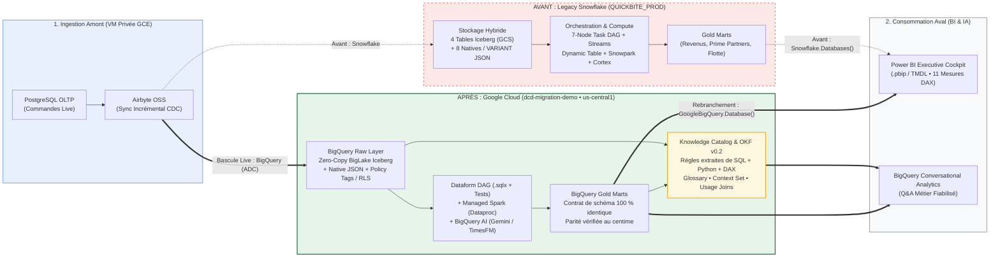

# Brief Démo & Slides — Migration Snowflake vers Google Cloud (QuickBite)

> **Objectif** : Document de pilotage pour finaliser le **recording de la démo avant jeudi** et fournir à **Johan** tous les éléments prêts à intégrer dans le pitch (message clé ultra-concis, diagramme Mermaid et déroulé des séquences).

---

## PARTIE 1 — Kit Prêt-à-Intégrer pour Johan (Slides du Pitch)

### 1.1 Ce que la démo prouve (Version ultra-concise pour les slides)

**Thèse centrale** : *Migrer de Snowflake vers Google Cloud avec **Antigravity** ne se limite pas à copier des tables — on remplace tout le cœur analytique **sans disruption** (de l'ingestion Airbyte jusqu'à Power BI) tout en **sacralisant les KPIs métier** pour l'IA.*

- **1. Zéro disruption de bout en bout** :
  - **En amont** : Airbyte bascule de Snowflake vers BigQuery en gardant ses curseurs incrémentaux — aucune commande live perdue.
  - **Sur les données** : les tables **Apache Iceberg** sur GCS sont montées en **Zero-Copy** dans BigQuery (**BigLake**) en quelques secondes.
  - **En aval** : **Power BI** (`.pbip / .tmdl`) est rebranché de Snowflake vers BigQuery sans casser une seule mesure DAX ni un seul visuel.
- **2. Modernisation complète Orchestration, Spark & IA** :
  - Un DAG complexe de **7 Snowflake Tasks** + Dynamic Table + Stored Proc est converti automatiquement en **Dataform** (Git + tests intégrés), Snowpark en **Managed Spark**, et Cortex en **BigQuery AI** (`AI.CLASSIFY`, `AI.FORECAST` TimesFM).
- **3. Sacralisation des KPIs & Parité au centime (Knowledge-as-Code)** :
  - Toute la logique métier cachée (SQL Snowflake, Snowpark Python, mesures DAX Power BI) est extraite vers **Open Knowledge Format (OKF)** et **Google Cloud Knowledge Catalog**.
  - **Preuve chiffrée** : parité mathématique exacte au centime (**\$153 150,49** de Net Revenue Q3 Restaurants), et **BigQuery Conversational Analytics** déjoue automatiquement les 5 pièges analytiques (SCD2 commissions, fan-out remboursements, snapshot trap flotte, jointure chargeback cachée, bug GPS JSON).

---

### 1.2 Diagramme d'Architecture (Mermaid)

*(Copiable tel quel sur [mermaid.live](https://mermaid.live) pour export SVG/PNG haute définition dans les slides.)*



---

### 1.3 Descriptif des 5 Séquences du Recording (Pour aligner les Slides & la Voix-Off)

| Séquence | Titre Slide / Chapitre | Durée cible vidéo | Ce qu'on voit à l'écran | Ce que ça prouve |
| :--- | :--- | :-: | :--- | :--- |
| **Acte 1** | **État des lieux & Audit IA** | ~45 s | Snowsight (`QUICKBITE_PROD`, 4 Iceberg + 8 FDN, 7 Tasks), Airbyte connecté à Snowflake, puis génération du rapport d'audit par Antigravity. | Antigravity cartographie automatiquement toute la chaîne (Airbyte -> Snowflake -> Power BI), pas seulement du SQL isolé. |
| **Acte 2** | **Migration Hybride & Bascule Airbyte** | ~1 min 30 | Montage Zero-Copy BigLake (4 tables Iceberg en < 5 s) + migration 8 tables FDN/JSON (`624 924` lignes) + bascule Airbyte -> BigQuery + **+50 commandes live** qui arrivent dans BigQuery. | Zéro recopie inutile sur Iceberg et bascule d'ingestion sans perte de données ni coupure. |
| **Acte 3** | **Task Graph -> Dataform, Spark & BQ AI** | ~2 min | Comparaison visuelle Snowsight Task Graph vs **Dataform Compiled Graph**, exécution du DAG, parité **`$153,150.49 == $153,150.49`**, puis PySpark & `AI.FORECAST` (TimesFM zero-shot). | Remplacement moderne et testé de l'orchestrateur Snowflake avec preuve mathématique au centime. |
| **Acte 4** | **Sacralisation des KPIs (OKF -> Knowledge Catalog)** | ~1 min 30 | Extraction de la logique SQL + Python + DAX Power BI vers `OKF v0.2`, enrichissement des schémas BigQuery + onglet **Insights** (Usage-Based Joins) + Glossary/Context Set. | Les règles métier ne sont plus cachées dans du code : elles deviennent gouvernées et réutilisables par tous. |
| **Acte 5** | **Power BI Rebranché & Conversational Analytics** | ~1 min 30 | Diff `.tmdl` (`Snowflake.Databases` -> `GoogleBigQuery.Database`), validation 0 mesure DAX cassée, puis 2 questions complexes posées en langage naturel dans **Conversational Analytics**. | Continuité BI immédiate + IA analytique qui répond juste (évite le piège SCD2 `+$127k` et le Snapshot Trap Londres `95` vs `76 734`). |

---

## PARTIE 2 — Pilotage Technique jusqu'à Jeudi (Fait vs. Reste à Faire)

### 2.1 Ce qui est DÉJÀ fait et vérifié en live

| Composant | Statut | Détail vérifié |
| :--- | :---: | :--- |
| **Données synthétiques déterministes** | ✅ Fait | `624 924` lignes (`seed = 42`) + `ground_truth_manifest.json` avec les 5 pièges analytiques. |
| **Snowflake Enterprise Trial (`QUICKBITE_PROD`)** | ✅ Fait | 4 tables Iceberg sur GCS + 8 FDN/`VARIANT`, 7-Node Task DAG + Dynamic Table + Stored Proc + Snowpark + ML.FORECAST + Masking/RLS + `QUERY_HISTORY`. Warehouses suspendus (`AUTO_SUSPEND = 60`). |
| **Prérequis GCP (`dcd-migration-demo`, `us-central1`)** | ✅ Fait | Bucket `gs://dcd-migration-demo-quickbite-lakehouse`, connexion BigLake `biglake-iceberg-conn`, datasets `quickbite_raw_ops`, `quickbite_raw_iot`, `quickbite_gold_mart` (vides, prêts pour Acte 2). |
| **Airbyte OSS + PostgreSQL OLTP (VM privée GCE)** | ✅ Fait | `quickbite-airbyte-vm` (`10.10.0.2`, `RUNNING`) : connexion `QuickBite OLTP -> Snowflake (Legacy)` testée (`job 2 succeeded`), destination BigQuery ADC (keyless) pré-testée et image Docker en cache. |
| **Projet Power BI (`.pbip` / `.tmdl`)** | ✅ Fait | Modèle sémantique complet avec 3 tables Gold et **11 mesures DAX** pointant actuellement sur Snowflake. |
| **6 Skills Antigravity + Scripts de migration/eval** | ✅ Fait | `.agents/skills/*`, `evals/verify_migration_parity.py`, `airbyte_cutover_controller.py`, `simulate_live_orders.py`, `open_airbyte_ui_tunnel.sh`. |

---

### 2.2 Ce qu'il RESTE à faire avant le recording de jeudi

1. **Répétition complète (Dry Run Actes 1 à 5)** *(Priorité #1 — à faire aujourd'hui/mercredi)* :
   - Les datasets BigQuery cibles sont encore vierges (`gcp-target/`, `okf/`, `bundle/` n'ont pas encore été générés).
   - Il faut exécuter une **passe complète Actes 1 -> 5** pour valider sur le terrain :
     - **Acte 2** : `migrate_hybrid_tables_to_bq.py` + bascule Airbyte (`cutover-to-bigquery` + `simulate_live_orders.py` + `trigger-sync`).
     - **Acte 3** : déploiement & compilation du DAG **Dataform** dans **BigQuery Studio** (vérifier les droits IAM du Service Account Dataform sur `dcd-migration-demo`), parité `verify_migration_parity.py`, script **Managed Spark**, et exécution réelle de **BigQuery AI** (`AI.CLASSIFY`, `AI.SCORE`, `AI.FORECAST` TimesFM — vérifier si une connexion Vertex AI / Cloud Resource est requise pour `AI.CLASSIFY`/`AI.SCORE`).
     - **Acte 4** : génération `okf/` & `bundle/`, enrichissement des métadonnées BigQuery + `QUERY_HISTORY`, et publication du **Context Set** dans **Knowledge Catalog** (vérifier l'affichage dans BigQuery Studio -> onglet **Insights**).
     - **Acte 5** : rebranchement Power BI `.tmdl` + validation `validate_tmdl_cutover.py` + test réel des prompts dans **BigQuery Conversational Analytics**.
2. **Script de reset propre (`scripts/reset_demo_to_before.sh`)** *(optionnel mais recommandé)* :
   - Permet de remettre BigQuery, Airbyte (`Legacy Snowflake` actif), `bi-powerbi/` (`git checkout`) et `gcp-target/` à leur état initial en 30 secondes si vous voulez refaire une prise propre pour le recording.
3. **Trancher l'affichage Power BI dans le recording** :
   - **Option rapide (recommandée pour vidéo)** : montrer le code `.tmdl` + `git diff` + sortie verte de `validate_tmdl_cutover.py` (zéro friction macOS).
   - **Option visuelle complète** : connecter le repo Git à **Power BI Service / Fabric** dans Chrome pour filmer le clic **Refresh** sur le rapport après l'Acte 5.
4. **Tourner et monter le recording (~6 à 8 min)** :
   - Enregistrer par petits clips (1 clip par Acte) en coupant les attentes de chargement, puis transmettre la vidéo + la Partie 1 à Johan.

---

## PARTIE 3 — Flow Complet & Commandes Exactes de la Démo

### Pré-vol (2 minutes avant de lancer l'enregistrement)
```bash
# 1. Ouvrir l'UI Airbyte sur http://localhost:8000 (dans un terminal dédié)
./scripts/open_airbyte_ui_tunnel.sh

# 2. Ouvrir 3 onglets Chrome côte à côte :
#    - Onglet 1 : Snowsight (https://app.snowflake.com/zsemzzy/il11049) -> QUICKBITE_PROD + Task Graph
#    - Onglet 2 : Airbyte UI (http://localhost:8000) -> Connexion Snowflake active en vert
#    - Onglet 3 : Google Cloud Console -> BigQuery Studio (dcd-migration-demo, us-central1)
```

### Flow pas-à-pas (Prompts Antigravity & Scripts sous-jacents)

| Étape | Prompt Antigravity (ou commande manuelle) | Script exécuté sous le capot | Résultat attendu à filmer |
| :--- | :--- | :--- | :--- |
| **Acte 1** *(Audit)* | *"Audit our live Snowflake QUICKBITE_PROD environment, upstream Airbyte Terraform pipeline, 7-node Snowflake Task DAG, and downstream Power BI (.pbip / TMDL) model. Generate the GCP migration blueprint in gcp-target/MIGRATION_AUDIT_REPORT.md."* | `.venv/bin/python .agents/skills/snowflake-live-audit/scripts/inspect_snowflake_estate.py` | Génération de `gcp-target/MIGRATION_AUDIT_REPORT.md` listant les 12 tables, 7 Tasks, politiques & 11 mesures DAX. |
| **Acte 2** *(Données + Airbyte)* | *"Execute the hybrid Snowflake-to-BigQuery data migration (Zero-Copy BigLake Iceberg for our 4 GCS Iceberg tables + Parquet/native JSON load for the 8 FDN/VARIANT tables), start background Data Profile scans, and re-point our Airbyte pipeline seamlessly from Snowflake to BigQuery."* | 1. `.venv/bin/python .agents/skills/snowflake-hybrid-data-cutover/scripts/migrate_hybrid_tables_to_bq.py`<br>2. `.venv/bin/python ingestion-airbyte/airbyte_cutover_controller.py --action cutover-to-bigquery`<br>3. `.venv/bin/python ingestion-airbyte/simulate_live_orders.py --count 50`<br>4. `.venv/bin/python ingestion-airbyte/airbyte_cutover_controller.py --action trigger-sync` | 12 tables peuplées dans BigQuery (`624 924` lignes) + bascule visible dans l'UI Airbyte + 50 nouvelles commandes (`2026-04-01`) dans `quickbite_raw_ops.CDC_dlv_ord_hdr`. |
| **Acte 3A** *(Tasks -> Dataform)* | *"Migrate our 7-node Snowflake Task Graph, Dynamic Table, Views, and Stored Procedure into a BigQuery Dataform repository under gcp-target/dataform/ (preserving exact uppercase Power BI schema contracts), compile and execute the Dataform DAG, and run evals/verify_migration_parity.py."* | 1. Compilation & exécution Dataform (`gcp-target/dataform/`)<br>2. `.venv/bin/python evals/verify_migration_parity.py --compare-live-snowflake` | Graphe compilé Dataform dans BigQuery Studio + console verte **`$153,150.49 == $153,150.49`** & **`$248,632.85 == $248,632.85`**. |
| **Acte 3B** *(Spark & BQ AI)* | *"Migrate our Snowpark fraud-scoring Python job to Google Cloud Managed Spark under gcp-target/spark/ and convert our Snowflake Cortex SQL & ML Forecast scripts to zero-shot BigQuery AI (AI.CLASSIFY, AI.SCORE, and TimesFM AI.FORECAST) under gcp-target/bigquery-ai/, then execute the BigQuery AI queries."* | `gcp-target/spark/pyspark_fraud_scoring_serverless.py` + `bq query` sur `gcp-target/bigquery-ai/cortex_to_bq_ai.sql` | Prévision 14 jours TimesFM (`FCT_REGIONAL_ORDER_FORECAST_14D`, 42 lignes) + triage IA des tickets clients (`BQ_AI_DISPUTE_TRIAGE`). |
| **Acte 4** *(KPIs -> OKF & KC)* | *"Extract all undocumented business logic, status code definitions, analytical join traps, and KPI formulas from Snowflake SQL, Snowpark Python, cortex_ops_model.yaml, and Power BI .tmdl DAX measures into Open Knowledge Format (okf/ and bundle/). Then push descriptions to BigQuery and seed query history for Knowledge Catalog Data Insights."* | `.venv/bin/python .agents/skills/extract-business-logic-to-okf/scripts/push_okf_metadata_and_seed_history.py` *(+ publication Context Set via `curate-context`)* | Colonnes documentées dans BigQuery Studio + onglet **Insights** montrant les jointures d'usage (`'CBK-'`, SCD2). |
| **Acte 5** *(Power BI & Q&A)* | *"Unplug our Power BI Semantic Model in bi-powerbi/ from Snowflake and re-point all table partitions to BigQuery using GoogleBigQuery.Database with the Storage API, keeping 100% of DAX measures and visuals intact, then validate the cutover."* | `.venv/bin/python .agents/skills/repoint-powerbi-to-bigquery/scripts/validate_tmdl_cutover.py` + prompts dans **BigQuery Conversational Analytics** (`evals/conversational_analytics_test_prompts.md`) | Validation 100 % verte des `.tmdl` + réponses IA exactes (**\$153 150,49** Q3 Restaurants, Top 3 zones déficit **5.50 / 4.50 / 3.25** sans Snapshot Trap). |
