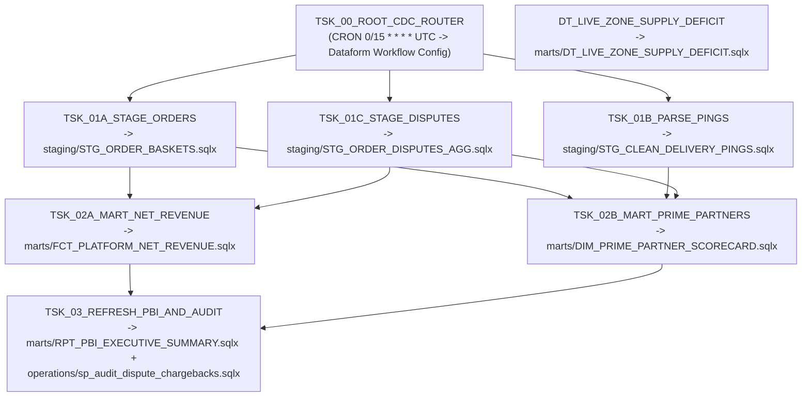

# QuickBite Snowflake-to-GCP Migration Audit Report (Act 1)

**Source Estate**: Snowflake Enterprise Trial (`QUICKBITE_PROD`, `us-central1`)
**Target Platform**: Google Cloud (`dcd-migration-demo`, `us-central1`, BigQuery + BigLake + Dataform + Managed Spark + BigQuery AI + Knowledge Catalog)

---

## 1. Hybrid Storage & Data Estate Inventory (`624,924` Historical Rows + Airbyte CDC)

| Schema.Table | Snowflake Format | Verified Rows | Target BigQuery Strategy | Recommended Partition / Cluster |
| :--- | :--- | --: | :--- | :--- |
| `OPS_RAW.DLV_ORD_HDR` | **Apache Iceberg (GCS)** + `STRM_DLV_ORD_HDR` | 90,000 | **Zero-Copy BigLake Iceberg** (`*_ICEBERG_EXT`) + Partitioned BQ Table | `PARTITION BY DATE(ORD_TS)` / `CLUSTER BY VERT_CD, ORD_STS_CD` |
| `OPS_RAW.DLV_ORD_ITEM_LN` | **Apache Iceberg (GCS)** | 277,146 | **Zero-Copy BigLake Iceberg** (`*_ICEBERG_EXT`) + Clustered BQ Table | `CLUSTER BY ORD_ID` |
| `OPS_RAW.ZNE_FLEET_SNAP` | **Apache Iceberg (GCS)** | 60,372 | **Zero-Copy BigLake Iceberg** (`*_ICEBERG_EXT`) + Partitioned BQ Table | `PARTITION BY DATE(SNAP_TS)` / `CLUSTER BY ZONE_ID` |
| `OPS_RAW.MRC_PAYOUT_LEDGER` | **Apache Iceberg (GCS)** | 13,746 | **Zero-Copy BigLake Iceberg** (`*_ICEBERG_EXT`) + Partitioned BQ Table | `PARTITION BY ISSUE_DT` / `CLUSTER BY PYT_STS_FLG, MRC_ID` |
| `IOT_RAW.APP_DELIVERY_PINGS` | **Native FDN (`VARIANT`)** + Snowpipe | 142,285 | Unload NDJSON GZIP -> **BigQuery Native `JSON`** | `PARTITION BY DATE(INGEST_TS)` / `CLUSTER BY ORD_ID` |
| `OPS_RAW.CUST_USER_MSTR` | Native FDN + `MSK_EMAIL_POLICY`, `MSK_PHONE_POLICY` | 30,000 | Parquet Unload -> BigQuery Native + **Policy Tags (CLS)** | `CLUSTER BY HOME_ZONE_ID, QB_PASS_FLG` |
| `OPS_RAW.CRR_COURIER_MSTR` | Native FDN + `MSK_PHONE_POLICY` | 2,500 | Parquet Unload -> BigQuery Native + **Policy Tags (CLS)** | `CLUSTER BY HOME_ZONE_ID, VEH_TP_CD` |
| `OPS_RAW.DSP_REFUND_FCT` | Native FDN + `STRM_DSP_REFUND_FCT` + Cortex | 6,243 | Parquet Unload -> BigQuery Native + `AI.CLASSIFY` / `AI.SCORE` | `PARTITION BY DATE(DSP_TS)` / `CLUSTER BY DSP_RSN_CD, RFND_STS_FLG` |
| `OPS_RAW.MRC_COMM_SCD2` | Native FDN | 1,100 | Parquet Unload -> BigQuery Native | `PARTITION BY EFF_FROM_DT` / `CLUSTER BY MRC_ID` |
| `OPS_RAW.SYS_CAL_DIM` | Native FDN | 1,096 | Parquet Unload -> BigQuery Native | Small dimension (unpartitioned) |
| `OPS_RAW.MRC_PARTNER_MSTR` | Native FDN | 400 | Parquet Unload -> BigQuery Native | `CLUSTER BY ZONE_ID, VERT_CD` |
| `OPS_RAW.GEO_ZONE_LKP` | Native FDN + `RAP_REGIONAL_ZONE_ACCESS` | 36 | Parquet Unload -> BigQuery Native + **BigQuery Row Access Policy** | Small dimension (unpartitioned) |

> **Upstream Airbyte Ingestion**: `ingestion-airbyte/airbyte_terraform/main.tf` & live Airbyte OSS (`quickbite-airbyte-vm`) currently sync `oltp.dlv_ord_hdr`, `oltp.dlv_ord_item_ln`, and `oltp.dsp_refund_fct` incrementally (`updated_at` cursor, `CDC_` prefix) to `QUICKBITE_PROD.OPS_RAW`. Cutover re-points the connection to `dcd-migration-demo.quickbite_raw_ops` using keyless GCE Service Account ADC.

---

## 2. 7-Node Snowflake Task DAG -> BigQuery Dataform Blueprint

---

## 3. Governance Policies & Undocumented Business Logic Inventory

- **Detected Snowflake Governance Policies**:
  - Dynamic Masking: `MSK_EMAIL_POLICY`, `MSK_PHONE_POLICY` -> BigQuery Data Catalog Policy Tags (CLS).
  - Row Access Policy: `RAP_REGIONAL_ZONE_ACCESS` (`REG_CD`) -> BigQuery `CREATE ROW ACCESS POLICY`.
- **Downstream Power BI Contract (`bi-powerbi/`)**:
  - DirectQuery via `Snowflake.Databases(...)` on 3 Gold tables (`FCT_PLATFORM_NET_REVENUE`, `DIM_PRIME_PARTNER_SCORECARD`, `DT_LIVE_ZONE_SUPPLY_DEFICIT`) with **11 DAX measures**.
  - **Contract Rule**: All Dataform Gold tables and columns MUST preserve exact **UPPERCASE** naming so Power BI re-points to `GoogleBigQuery.Database([UseStorageApi=true])` with zero broken visuals.
- **Hidden Analytical Traps to Rescue into OKF v0.2 & Knowledge Catalog**:
  1. **SCD2 Merchant Commissions** (`MRC_COMM_SCD2`): Must join on `CAL_DT BETWEEN EFF_FROM_DT AND EFF_TO_DT`, never `IS_CURR_FLG = 1` (`+$127,296.80` overstatement trap in Q3 2025).
  2. **Refund Fan-Out** (`DSP_REFUND_FCT`): Must pre-aggregate refunds at `ORD_ID` grain filtering `RFND_STS_FLG = 1` before joining item lines (`$248,632.85` true vs `$813,512.14` fanned-out).
  3. **Fleet Snapshot Trap** (`ZNE_FLEET_SNAP`): Non-additive stock metric — must filter to latest `SNAP_TS` per zone (`95` online couriers in London vs `76,734` naive sum).
  4. **Hidden Chargeback Join** (`MRC_PAYOUT_LEDGER`): Joins on `CONCAT('CBK-', ORD_ID) = REF_DOC_TXT`.
  5. **IoT Telemetry Bug**: Exclude `app_ver = '3.8.0-beta'` (`1,933` orders with corrupted GPS kitchen timers).
