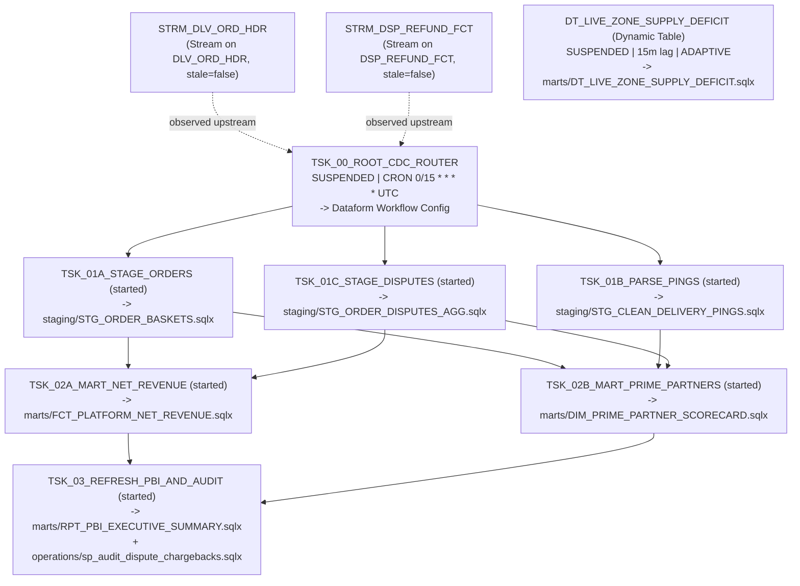

# UrbanFork Snowflake-to-GCP Migration Audit Report & Blueprint (Act 1)

**Audit Mode**: Live Snowflake Discovery + Static Source / Config Inspection  
**Audit Date**: 2026-11-25 (UTC snapshot persisted to [`gcp-target/snowflake_live_inventory.json`](./snowflake_live_inventory.json))  
**Source Estate**: Snowflake `URBANFORK_PROD` (`zsemzzy-il11049.snowflakecomputing.com`, Enterprise Trial, `us-central1`)  
**Target Platform**: Google Cloud Project `dcd-migration-demo` (`us-central1`) — BigQuery (`urbanfork_raw_ops`, `urbanfork_raw_iot`, `urbanfork_gold_mart`), BigLake Iceberg (`biglake-iceberg-conn`), GCS Lakehouse (`dcd-migration-demo-urbanfork-lakehouse`), Dataform, Dataproc Serverless (Managed Spark), BigQuery AI, and Knowledge Catalog (`urbanfork-enterprise-glossary`, `urbanfork-marketplace-context`).

---

## Executive Summary

| Metric / Object Category | Live Snowflake Count | Notes / Status |
| :--- | --: | :--- |
| Schemas in `URBANFORK_PROD` | 7 | `OPS_RAW`, `IOT_RAW`, `MART`, `GOVERNANCE`, `PUBLIC`, `INFORMATION_SCHEMA`, **`airbyte_internal`** (runtime) |
| Core Raw Tables (Iceberg on GCS) | 4 | **441,264 rows** (`2,903,040 B` / `2.77 MiB`) — Zero-Copy BigLake mount |
| Core Raw Tables (Native Snowflake FDN) | 8 | **183,660 rows** (`4,563,456 B` / `4.35 MiB`), incl. `IOT_RAW.APP_DELIVERY_PINGS` (`VARIANT`) |
| **Core Raw Subtotal (`ground_truth_manifest.json`)** | **12** | **624,924 rows** (`7,466,496 B` / `7.12 MiB`) — 100% row-count parity verified |
| Runtime Airbyte CDC Landing Tables (`CDC_*`) | 3 | **2 rows** (`3,584 B`) — Native FDN w/ `VARIANT` `_AIRBYTE_META` (discovered live) |
| `MART` Materialized Tables (incl. 1 Dynamic Table) | 8 | **236,510 rows** (`5,551,104 B` / `5.29 MiB`) |
| `MART` Analytical Views | 3 | `VW_PLATFORM_NET_REVENUE`, `VW_DELIVERY_SLA_TELEMETRY`, `VW_PRIME_PARTNER_SCORECARD` |
| Snowflake Task DAG Nodes (`MART`) | 7 | Root `TSK_00` **`suspended`** (CRON `0/15 * * * * UTC`); 6 child tasks **`started`** |
| CDC Streams (`OPS_RAW`) | 2 | `STRM_DLV_ORD_HDR`, `STRM_DSP_REFUND_FCT` (`stale=false`, `stale_after=2026-12-08`) |
| Snowpipe (`IOT_RAW`) | 1 | `PIPE_APP_DELIVERY_PINGS` (`AUTO_INGEST = FALSE`) |
| Stored Procedures / Persistent UDFs | 1 / 0 | `SP_AUDIT_DISPUTE_CHARGEBACKS(FLOAT)`; Snowpark `UDF_COMPUTE_ABUSE_INDEX` is temp/session-scoped |
| Cortex AI & ML Forecast Models (live) | 0 | Defined in `05_cortex_ai_and_ml.sql`, **not materialized live** on trial instance |
| Governance Tags / Masking / Row Access Policies | 1 / 2 / 1 | All 4 policy attachments & 3 tag attachments verified `ACTIVE` |
| Active Warehouses (application) | 2 | `UF_LOAD_WH` & `UF_TRANSFORM_WH` (`X-Small`, `auto_suspend=60s`, suspended post-audit) |

### Key Live Drift & Pre-Migration Findings
1. **Live Airbyte CDC footprint present in Snowflake**: Three `CDC_*` landing tables (`OPS_RAW.CDC_DLV_ORD_HDR` = 1 row, `CDC_DLV_ORD_ITEM_LN` = 1 row, `CDC_DSP_REFUND_FCT` = 0 rows), an `airbyte_internal` schema, and 7 internal `airbyte_stage_*` stages are live on Snowflake (created `2026-11-25 00:03:47 -08:00`). None of the `CDC_*` tables are listed in `agent-config.json`.
2. **Terraform config drift & missing variables**: `ingestion-airbyte/airbyte_terraform/main.tf` already points `airbyte_connection.urbanfork_oltp_incremental` to `airbyte_destination_bigquery.bigquery_raw_ops` (while leaving legacy `airbyte_destination_snowflake.snowflake_ops_raw` defined). Additionally, `main.tf` references `var.bq_raw_dataset` and `var.gcp_region` which are **missing from `variables.tf`** (would fail `terraform validate`/`plan` until declared).
3. **Cortex AI / ML Forecast not materialized live**: `MART.CORTEX_DISPUTE_TRIAGE_SAMPLE`, `MART.FCT_DAILY_REGION_DEMAND_TRAIN`, `MART.FCT_REGIONAL_ORDER_FORECAST_14D`, and `MART.MDL_REGIONAL_ORDER_FORECAST` do **not** exist in the live `URBANFORK_PROD.MART` schema (soft-skipped by `data-generator/seed_snowflake_instance.py`). Source definitions are in `snowflake-source/05_cortex_ai_and_ml.sql`.
4. **Tableau Cloud BI Workbooks (`bi-tableau/`)**: Both `UrbanFork_Executive_Cockpit_Snowflake.twb` and `UrbanFork_Executive_Cockpit_BigQuery.twb` bind `FCT_PLATFORM_NET_REVENUE` (17 uppercase columns, 3 worksheets, 4 executive Calculated Fields) with 100% column parity and matched `'Restaurant'` / `'Grocery'` color palettes.
5. **Uncreated RBAC roles referenced in Row Access Policy**: `GOVERNANCE.RAP_REGIONAL_ZONE_ACCESS` checks `UF_ANALYST_EMEA`, `UF_ANALYST_AMER`, and `UF_ANALYST_APAC`, though `06_governance_policies.sql` only creates `UF_ANALYST_EMEA`. Ensure all regional Google Groups are provisioned when creating BigQuery Row Access Policies.

---

## 1. Storage, Table & Integration Inventory

### 1.1 Cloud Integrations, Volumes, Stages & Pipe
- **External Volume**: `URBANFORK_GCS_ICEBERG_VOL` (`ALLOW_WRITES = TRUE`, `gcs://dcd-migration-demo-urbanfork-lakehouse/iceberg/`)
- **Storage Integration**: `URBANFORK_GCS_INT` (`TYPE = EXTERNAL_STAGE`, `STORAGE_PROVIDER = GCS`, `ENABLED = TRUE`, allowed: `gcs://dcd-migration-demo-urbanfork-lakehouse/`)
- **Stages (10 live)**:
  - External GCS: `OPS_RAW.GCS_EXPORT_STAGE` (`gcs://dcd-migration-demo-urbanfork-lakehouse/fdn-export/`, `PARQUET`, uses `URBANFORK_GCS_INT`)
  - Internal app stages: `OPS_RAW.SEED_LOAD_STAGE` (`CSV GZIP`), `IOT_RAW.IOT_LANDING_STAGE` (`JSONL GZIP`)
  - Internal Airbyte stages (7): 4 in `OPS_RAW` (`airbyte_stage_CDC_*` + connection test stage) and 3 in `airbyte_internal`
- **Snowpipe (1 live)**: `IOT_RAW.PIPE_APP_DELIVERY_PINGS` (`AUTO_INGEST = FALSE`, copies `@IOT_RAW.IOT_LANDING_STAGE` into `IOT_RAW.APP_DELIVERY_PINGS`) -> Migrate to **Cloud Storage Notification / Pub/Sub -> BigQuery Subscription** (or Storage Transfer / `LOAD DATA`).

### 1.2 Core Apache Iceberg Tables on GCS (`4` Tables — `441,264` Rows, `2.77 MiB`)
All four tables use `CATALOG = 'SNOWFLAKE'` (managed Iceberg) backed by `URBANFORK_GCS_ICEBERG_VOL` in `gcs://dcd-migration-demo-urbanfork-lakehouse/iceberg/`. **Target Strategy**: **Zero-Copy BigLake Iceberg** external mount via `biglake-iceberg-conn` (`*_ICEBERG_EXT`), paired with optional native partitioned/clustered replicas for high-QPS serving if required.

| Schema.Table | Live Rows | Bytes | GCS Iceberg `base_location` | Snowflake Extras | Recommended BigQuery Partition / Cluster |
| :--- | --: | --: | :--- | :--- | :--- |
| `OPS_RAW.DLV_ORD_HDR` | 90,000 | 1,573,376 | `ops_raw/dlv_ord_hdr.hT5lucLZ/` | Stream `STRM_DLV_ORD_HDR` | `PARTITION BY DATE(ORD_TS)` / `CLUSTER BY VERT_CD, ORD_STS_CD` |
| `OPS_RAW.DLV_ORD_ITEM_LN` | 277,146 | 817,664 | `ops_raw/dlv_ord_item_ln.YZeGCtQW/` | — | `CLUSTER BY ORD_ID` |
| `OPS_RAW.ZNE_FLEET_SNAP` | 60,372 | 384,000 | `ops_raw/zne_fleet_snap.JG2L2ROW/` | Snapshot source for `DT_LIVE_ZONE_SUPPLY_DEFICIT` | `PARTITION BY DATE(SNAP_TS)` / `CLUSTER BY ZONE_ID` |
| `OPS_RAW.MRC_PAYOUT_LEDGER` | 13,746 | 128,000 | `ops_raw/mrc_payout_ledger.4cUAdMJr/` | Target of `SP_AUDIT_DISPUTE_CHARGEBACKS` `UPDATE` | `PARTITION BY ISSUE_DT` / `CLUSTER BY PYT_STS_FLG, MRC_ID` |

### 1.3 Core Native Snowflake FDN Tables (`8` Tables — `183,660` Rows, `4.35 MiB`)
**Target Strategy**: Unload via `OPS_RAW.GCS_EXPORT_STAGE` (`PARQUET` for relational tables, `NDJSON GZIP` for `VARIANT`) and load into native BigQuery tables in `urbanfork_raw_ops` / `urbanfork_raw_iot`.

| Schema.Table | Live Rows | Bytes | Snowflake Format / Clustering | Semi-Structured / Policies | Target BQ Dataset & Recommended Partition / Cluster |
| :--- | --: | --: | :--- | :--- | :--- |
| `IOT_RAW.APP_DELIVERY_PINGS` | 142,285 | 3,548,672 | Native FDN; `LINEAR(TO_DATE(INGEST_TS))` | **`PAYLOAD VARIANT`** -> **`JSON`**; `PIPE_APP_DELIVERY_PINGS` | `urbanfork_raw_iot` / `PARTITION BY DATE(INGEST_TS)` / `CLUSTER BY ORD_ID` |
| `OPS_RAW.CUST_USER_MSTR` | 30,000 | 796,672 | Native FDN | Tag + `MSK_EMAIL_POLICY`, `MSK_PHONE_POLICY` | `urbanfork_raw_ops` / `CLUSTER BY HOME_ZONE_ID, UF_PASS_FLG` |
| `OPS_RAW.DSP_REFUND_FCT` | 6,243 | 151,552 | Native FDN; `LINEAR(TO_DATE(DSP_TS), DSP_RSN_CD)` | Stream `STRM_DSP_REFUND_FCT` | `urbanfork_raw_ops` / `PARTITION BY DATE(DSP_TS)` / `CLUSTER BY DSP_RSN_CD, RFND_STS_FLG` |
| `OPS_RAW.CRR_COURIER_MSTR` | 2,500 | 46,080 | Native FDN | Tag + `MSK_PHONE_POLICY` | `urbanfork_raw_ops` / `CLUSTER BY HOME_ZONE_ID, VEH_TP_CD` |
| `OPS_RAW.MRC_COMM_SCD2` | 1,100 | 5,120 | Native FDN | SCD Type 2 effective range | `urbanfork_raw_ops` / `PARTITION BY EFF_FROM_DT` / `CLUSTER BY MRC_ID` *(or unpartitioned; tiny table)* |
| `OPS_RAW.SYS_CAL_DIM` | 1,096 | 6,144 | Native FDN (`DATA_RETENTION = 7d`) | Calendar dim (`DT_SK`, `FISC_YR_N`) | `urbanfork_raw_ops` / Unpartitioned small dimension |
| `OPS_RAW.MRC_PARTNER_MSTR` | 400 | 7,680 | Native FDN; `LINEAR(ZONE_ID, VERT_CD)` | — | `urbanfork_raw_ops` / `CLUSTER BY ZONE_ID, VERT_CD` |
| `OPS_RAW.GEO_ZONE_LKP` | 36 | 1,536 | Native FDN | `RAP_REGIONAL_ZONE_ACCESS` (`REG_CD`) | `urbanfork_raw_ops` / Unpartitioned small dimension + **BigQuery RLS** |

### 1.4 Discovered Live Airbyte CDC Tables (`3` Tables — `2` Rows, `3,584 B`)
Each carries an Airbyte metadata column `_AIRBYTE_META` of type **`VARIANT`** (auto-mapped to BigQuery `JSON` upon destination cutover).

| Schema.Table | Live Rows | Bytes | Source `oltp.*` Stream | Strategy |
| :--- | --: | --: | :--- | :--- |
| `OPS_RAW.CDC_DLV_ORD_HDR` | 1 | 2,048 | `oltp.dlv_ord_hdr` (`ORD-0090000` watermark) | Managed directly by Airbyte BigQuery destination after cutover |
| `OPS_RAW.CDC_DLV_ORD_ITEM_LN` | 1 | 1,536 | `oltp.dlv_ord_item_ln` (`LN-00277146` watermark) | Managed directly by Airbyte BigQuery destination after cutover |
| `OPS_RAW.CDC_DSP_REFUND_FCT` | 0 | 0 | `oltp.dsp_refund_fct` | Managed directly by Airbyte BigQuery destination after cutover |

### 1.5 `MART` Materialized Tables & Legacy Views (`8` Tables + `3` Views)
Do **not** dump-and-load these from Snowflake; re-materialize them natively via **Dataform** (`urbanfork_gold_mart`) and **Managed Spark**, then verify cent-level parity against Snowflake outputs.

| Schema.Object | Live Type | Live Rows | Bytes | Produced By | Target GCP Artifact (`gcp-target/`) |
| :--- | :--- | --: | --: | :--- | :--- |
| `MART.STG_ORDER_BASKETS` | Table | 90,000 | 2,869,760 | `TSK_01A_STAGE_ORDERS` | `dataform/definitions/staging/STG_ORDER_BASKETS.sqlx` |
| `MART.STG_CLEAN_DELIVERY_PINGS` | Table | 80,937 | 1,455,104 | `TSK_01B_PARSE_PINGS` | `dataform/definitions/staging/STG_CLEAN_DELIVERY_PINGS.sqlx` |
| `MART.STG_ORDER_DISPUTES_AGG` | Table | 6,243 | 55,808 | `TSK_01C_STAGE_DISPUTES` | `dataform/definitions/staging/STG_ORDER_DISPUTES_AGG.sqlx` |
| `MART.FCT_PLATFORM_NET_REVENUE` | Table | 30,704 | 746,496 | `TSK_02A_MART_NET_REVENUE` | `dataform/definitions/marts/FCT_PLATFORM_NET_REVENUE.sqlx` |
| `MART.DIM_PRIME_PARTNER_SCORECARD` | Table | 400 | 15,360 | `TSK_02B_MART_PRIME_PARTNERS` | `dataform/definitions/marts/DIM_PRIME_PARTNER_SCORECARD.sqlx` |
| `MART.RPT_PBI_EXECUTIVE_SUMMARY` | Table | 144 | 3,584 | `TSK_03_REFRESH_PBI_AND_AUDIT` | `dataform/definitions/marts/RPT_PBI_EXECUTIVE_SUMMARY.sqlx` |
| `MART.DT_LIVE_ZONE_SUPPLY_DEFICIT` | **Dynamic Table** | 36 | 3,584 | Lag `15 min` (`SUSPENDED`) | `dataform/definitions/marts/DT_LIVE_ZONE_SUPPLY_DEFICIT.sqlx` |
| `MART.USER_FRAUD_RISK_SCORES` | Table | 28,046 | 401,408 | Snowpark / SQL fraud scorer | `spark/pyspark_fraud_scoring_serverless.py` |
| `MART.VW_PLATFORM_NET_REVENUE` | View | — | — | Legacy view (`04_*.sql`) | Superseded by `FCT_PLATFORM_NET_REVENUE` |
| `MART.VW_DELIVERY_SLA_TELEMETRY` | View | — | — | Legacy view (`FLATTEN` + **`ASOF JOIN`**) | `dataform/definitions/marts/VW_DELIVERY_SLA_TELEMETRY.sqlx` *(rewrite `ASOF JOIN` using window/range logic)* |
| `MART.VW_PRIME_PARTNER_SCORECARD` | View | — | — | Legacy view (`04_*.sql`) | Superseded by `DIM_PRIME_PARTNER_SCORECARD` |

> **Recommended Partitioning / Clustering for Target Gold Marts**:
> - `FCT_PLATFORM_NET_REVENUE`: `PARTITION BY CAL_DT` / `CLUSTER BY REG_CD, VERT_CD, ZONE_ID`
> - `DIM_PRIME_PARTNER_SCORECARD`: Unpartitioned / `CLUSTER BY REG_CD, IS_PRIME_PARTNER`
> - `DT_LIVE_ZONE_SUPPLY_DEFICIT`: Unpartitioned (36 zones)
> - `RPT_PBI_EXECUTIVE_SUMMARY`: `PARTITION BY REPORT_MONTH` / `CLUSTER BY REG_CD, VERTICAL_NM`
> - `STG_ORDER_BASKETS`: `PARTITION BY ORD_DT` / `CLUSTER BY VERT_CD, ORD_STS_CD`
> - `STG_CLEAN_DELIVERY_PINGS`: `PARTITION BY DATE(DELIVERED_PING_TS)` / `CLUSTER BY ORD_ID`
> - `USER_FRAUD_RISK_SCORES`: Unpartitioned / `CLUSTER BY RISK_TIER, HOME_ZONE_ID`

### 1.6 Governance Policies & Security Mapping (Verified Live in `GOVERNANCE`)
All policies and tags were queried from `URBANFORK_PROD` and `SNOWFLAKE.ACCOUNT_USAGE` (`TAG_REFERENCES` & `POLICY_REFERENCES`).

| Snowflake Object | Type | Attached Target(s) | Live Status | Enforcement Logic | BigQuery Target Mapping |
| :--- | :--- | :--- | :--- | :--- | :--- |
| `GOVERNANCE.PII_SENSITIVITY` | Object Tag | `CUST_USER_MSTR.EMAIL_TXT` (`CONFIDENTIAL_PII`), `CUST_USER_MSTR.PHONE_TXT` (`RESTRICTED_CONTACT`), `CRR_COURIER_MSTR.PHONE_TXT` (`RESTRICTED_CONTACT`) | Active (3 bindings) | Allowed values: `PUBLIC`, `CONFIDENTIAL_PII`, `RESTRICTED_CONTACT` | Cloud Data Catalog Taxonomy (`UrbanFork_PII_Taxonomy`, `us-central1`) |
| `GOVERNANCE.MSK_EMAIL_POLICY` | Masking Policy (CLS) | `OPS_RAW.CUST_USER_MSTR.EMAIL_TXT` | `ACTIVE` | Unmasked for `ACCOUNTADMIN` / `SECURITYADMIN`; else `LEFT(val,2) \|\| '****@****.com'` | Policy Tag **`CONFIDENTIAL_PII`** w/ Data Masking rule (`DEFAULT_MASKING_VALUE` / `SHA256` or custom email mask) |
| `GOVERNANCE.MSK_PHONE_POLICY` | Masking Policy (CLS) | `OPS_RAW.CUST_USER_MSTR.PHONE_TXT`, `OPS_RAW.CRR_COURIER_MSTR.PHONE_TXT` | `ACTIVE` | Unmasked for `ACCOUNTADMIN` / `SECURITYADMIN`; else `'***-***-' \|\| RIGHT(val,4)` | Policy Tag **`RESTRICTED_CONTACT`** w/ Data Masking rule (`LAST_FOUR_CHARACTERS`) |
| `GOVERNANCE.RAP_REGIONAL_ZONE_ACCESS` | Row Access Policy (RLS) | `OPS_RAW.GEO_ZONE_LKP` (`REG_CD`) | `ACTIVE` | Full access for `ACCOUNTADMIN`/`SECURITYADMIN`; `UF_ANALYST_EMEA` -> `'EMEA'`, `UF_ANALYST_AMER` -> `'AMER'`, `UF_ANALYST_APAC` -> `'APAC'` | `CREATE ROW ACCESS POLICY` on `urbanfork_raw_ops.GEO_ZONE_LKP` (`gcp-target/security/bigquery_rls_and_masking.sql`) |

---

## 2. Orchestrator DAG, Streams, Dynamic Table, Snowpark & Cortex AI Map

### 2.1 7-Node Snowflake Task DAG -> BigQuery Dataform Blueprint

**Task & SQL Dialect Migration Notes**:
- **CDC Streams (`OPS_RAW.STRM_DLV_ORD_HDR`, `OPS_RAW.STRM_DSP_REFUND_FCT`)**: Both streams are `DEFAULT` mode and `stale=false` (`stale_after=2026-12-08`). Currently the tasks perform full `INSERT OVERWRITE` refreshes rather than reading stream metadata (`METADATA$ACTION`). Migrate either to Dataform `type: "table"` (matching current behavior) or `type: "incremental"` using `updated_at` / BigQuery Change History (`APPENDS()`).
- **Dynamic Table (`MART.DT_LIVE_ZONE_SUPPLY_DEFICIT`)**: Suspended (`lag=15m`, last refreshed `2026-11-24 23:59:48 -08:00`, `36` rows). Convert to a Dataform scheduled table (or continuous materialized query/scheduled query every 15 minutes; note `QUALIFY RANK()` isn't natively supported in standard BigQuery continuous Materialized Views).
- **Stored Procedure (`MART.SP_AUDIT_DISPUTE_CHARGEBACKS(FLOAT)`)**: Invoked by `TSK_03_REFRESH_PBI_AND_AUDIT` with threshold `500.0`. Updates `OPS_RAW.MRC_PAYOUT_LEDGER.PYT_STS_FLG = 9` on scheduled `STL-%` payouts when a merchant's total `CBK-%` chargebacks `>= 500.0`. Convert to a Dataform `operations` action (`sp_audit_dispute_chargebacks.sqlx`) using BigQuery Scripting. *(Note: if `MRC_PAYOUT_LEDGER` stays a read-only BigLake external Iceberg table, write operations require either a BigLake managed Iceberg / Apache Iceberg writable catalog or executing the `UPDATE` against a native BigQuery table replica.)*
- **Key Snowflake -> BigQuery SQL Dialect Translations**:
  - `IFF(cond, a, b)` -> `IF(cond, a, b)`
  - `ZEROIFNULL(x)` -> `COALESCE(x, 0)`
  - `COUNT_IF(expr)` -> `COUNTIF(expr)`
  - `VARIANT` path `p.PAYLOAD:metrics.prep_sec::VARCHAR` -> `JSON_VALUE(p.PAYLOAD, '$.metrics.prep_sec')`
  - `TRY_TO_NUMBER(...)` -> `SAFE_CAST(... AS INT64/NUMERIC)`
  - `ARRAY_CONTAINS('SLA_EXCEEDED'::VARIANT, p.PAYLOAD:anomaly_flags)` -> `'SLA_EXCEEDED' IN UNNEST(JSON_VALUE_ARRAY(p.PAYLOAD, '$.anomaly_flags'))`
  - `LATERAL FLATTEN(input => ...)` -> `CROSS JOIN UNNEST(JSON_VALUE_ARRAY(...))`
  - `LISTAGG(DISTINCT x, ',') WITHIN GROUP (...)` -> `STRING_AGG(DISTINCT x, ',' ORDER BY x)`
  - `DATEADD('day', -90, dt)` -> `DATE_SUB(dt, INTERVAL 90 DAY)`
  - `ASOF JOIN ... MATCH_CONDITION (lp.INGEST_TS <= d.DSP_TS)` in `VW_DELIVERY_SLA_TELEMETRY` -> `LEFT JOIN` with range filter + `QUALIFY ROW_NUMBER() OVER (PARTITION BY ... ORDER BY d.DSP_TS ASC) = 1` (or `ARRAY_AGG(... LIMIT 1)`).

### 2.2 Snowpark Python UDF -> Managed Spark (Dataproc Serverless)
- **Source**: `snowflake-source/snowpark/snowpark_merchant_fraud_scoring.py`
- **UDF**: `UDF_COMPUTE_ABUSE_INDEX(delivered_cnt, dispute_cnt, flagged_abuse_cnt, distinct_dispute_zones) -> FLOAT` registered with **`is_permanent=False`** (so `SHOW USER FUNCTIONS` returns `0` persistent functions live).
- **Inputs -> Output**: Reads `OPS_RAW.DLV_ORD_HDR` (`ORD_STS_CD = 'D'`), `OPS_RAW.DSP_REFUND_FCT`, and `OPS_RAW.CUST_USER_MSTR`; writes `MART.USER_FRAUD_RISK_SCORES` (**28,046 rows** live).
- **Formula & Tiers** (`0.0` if `delivered_cnt < 5` or `dispute_cnt == 0`):
  - `0.50 * min(dispute_cnt / delivered_cnt, 1.0)`
  - `+ 0.30 * min(flagged_abuse_cnt / dispute_cnt, 1.0)` where abuse = `DSP_RSN_CD = 4 OR RFND_STS_FLG = 9`
  - `+ 0.20 * (1.0 if distinct_dispute_zones >= 3 else distinct_dispute_zones / 3.0)`
  - Tiers: `>= 0.75` `HIGH_RISK_BLOCK_AUTO_REFUND` (45 planted serial abusers per manifest), `>= 0.40` `MEDIUM_WATCHLIST`, else `LOW_NORMAL`.
- **Target**: `gcp-target/spark/pyspark_fraud_scoring_serverless.py` on **Dataproc Serverless** (`spark-bigquery` Storage API connector). Replaces row-by-row Python `@udf` with vectorized Catalyst/Tungsten column expressions (zero JVM-Python serialization penalty).

### 2.3 Cortex AI, ML Forecast & Legacy Semantic Model
| Snowflake Source Artifact | Live Status | Legacy Feature | Target Google Cloud Service |
| :--- | :--- | :--- | :--- |
| `05_cortex_ai_and_ml.sql` (`CORTEX_DISPUTE_TRIAGE_SAMPLE`) | **Not deployed live** (trial-skipped) | `AI_SENTIMENT(CUST_TICKET_TXT)` | BigQuery **`AI.SCORE`** (calibrated urgency/severity `0.0–1.0`) |
| `05_cortex_ai_and_ml.sql` (`CORTEX_DISPUTE_TRIAGE_SAMPLE`) | **Not deployed live** | `AI_CLASSIFY(CUST_TICKET_TXT, 4 labels)` | BigQuery **`AI.CLASSIFY`** (zero-shot Gemini 2.5 Flash) |
| `05_cortex_ai_and_ml.sql` (`MDL_REGIONAL_ORDER_FORECAST`) | **Not deployed live** (`0` models) | `SNOWFLAKE.ML.FORECAST` (3-step `CREATE MODEL` + `CALL` + `RESULT_SCAN`) | BigQuery **`AI.FORECAST`** (`TimesFM 2.5`, 14-day horizon by `REG_CD`, single SQL query, zero training) |
| `cortex-analyst/cortex_ops_model.yaml` | Repo file only (abandoned POC) | Covers **3 of 12** tables (`DLV_ORD_HDR`, `DLV_ORD_ITEM_LN`, `GEO_ZONE_LKP`); uses `IFF()` | Rescued into **Open Knowledge Format (OKF v0.2)** `bundle/` + **Knowledge Catalog** Glossary & Context Set |

---

## 3. Upstream Airbyte Ingestion & Downstream BI Dependencies

### 3.1 Airbyte Terraform Config (`ingestion-airbyte/airbyte_terraform/`)
- **Source**: `airbyte_source_postgres.urbanfork_oltp` (`oltp` schema on `urbanfork-oltp-postgres:5439`, user-defined cursor mode, `ssl_mode = disable`).
- **Incremental Streams (`prefix = "CDC_"`, `schedule = "0 0/15 * * * ?"`, `sync_mode = "incremental_deduped_history"`)**:
  - `oltp.dlv_ord_hdr` — cursor `["updated_at"]`, PK `[["ord_id"]]` (live watermark: `ORD-0090000`, `2026-03-31 23:58:00`)
  - `oltp.dlv_ord_item_ln` — cursor `["updated_at"]`, PK `[["ord_ln_id"]]` (live watermark: `LN-00277146`)
  - `oltp.dsp_refund_fct` — cursor `["updated_at"]`, PK `[["dsp_id"]]` (`0` rows synced)
- **Live Controller (`ingestion-airbyte/airbyte_cutover_controller.py`)**: Operates Airbyte OSS via IAP SSH against GCE VM `quickbite-airbyte-vm` (`us-central1-a`), using keyless GCE Service Account ADC for the BigQuery destination (`batched_standard_inserts` / `Standard` load mode).
- **Remediation Required Before Running Terraform**:
  - Declare missing variables `bq_raw_dataset` (default `"urbanfork_raw_ops"`) and `gcp_region` (default `"us-central1"`) in [`ingestion-airbyte/airbyte_terraform/variables.tf`](../ingestion-airbyte/airbyte_terraform/variables.tf).
  - Verify whether `airbyte_destination_snowflake.snowflake_ops_raw` should remain during parallel validation or be decommissioned (`terraform destroy -target=...`) after Act 2 cutover.

### 3.2 Downstream BI Dependencies
- **Active Workbook — Tableau Cloud (`bi-tableau/`)**:
  - Legacy workbook: [`bi-tableau/UrbanFork_Executive_Cockpit_Snowflake.twb`](../bi-tableau/UrbanFork_Executive_Cockpit_Snowflake.twb) (`class='snowflake'`, `URBANFORK_PROD.MART.FCT_PLATFORM_NET_REVENUE`, `UF_TRANSFORM_WH`).
  - Target workbook: [`bi-tableau/UrbanFork_Executive_Cockpit_BigQuery.twb`](../bi-tableau/UrbanFork_Executive_Cockpit_BigQuery.twb) (`class='bigquery'`, `dcd-migration-demo.urbanfork_gold_mart.FCT_PLATFORM_NET_REVENUE`, `google-sql`, OAuth).
  - Automated cutover script: [`bi-tableau/repoint_twb_to_bigquery.py`](../bi-tableau/repoint_twb_to_bigquery.py).
  - Consumes all **17 UPPERCASE columns** of `FCT_PLATFORM_NET_REVENUE`, renders dashboard **`UrbanFork Executive Cockpit`** (3 worksheets: `KPI Banner`, `Monthly Net Revenue`, `Regional Performance`), and embeds **4 Calculated Fields**:
    1. `Effective Take-Rate %`: `SUM([PLATFORM_NET_REVENUE_USD]) / SUM([GROSS_MERCHANDISE_VALUE_USD])`
    2. `Q3 2025 Restaurant Net Revenue ($)`: Calendar `2025-07-01..2025-09-30`, `VERT_CD = 1` (benchmark: **`$153,150.49`**)
    3. `FY25 Restaurant Net Revenue ($)`: `FISC_YR_N = 2025`, `VERT_CD = 1` (benchmark: **`$937,401.38`**)
    4. `Approved Refund Ratio %`: `SUM([APPROVED_REFUNDS_USD]) / SUM([GROSS_MERCHANDISE_VALUE_USD])`
  - *Palette Defect to Fix*: `.twb` XML color encodings map `"RESTAURANT"` and `"GROCERY_DARK_STORE"`, whereas `FCT_PLATFORM_NET_REVENUE.VERTICAL_NM` outputs **`'Restaurant'`** and **`'Grocery'`**.
- **Schema Contract Rule**: Preserve **exact UPPERCASE** table and column names across all `urbanfork_gold_mart` targets so BI re-pointing requires zero formula or visual rewrites.

---

## 4. Hidden Business Logic & Analytical Parity Traps (For OKF v0.2 / Knowledge Catalog)

All five domain traps are verified against `data-generator/output/ground_truth_manifest.json` (`seed=42`):

| # | Trap / Business Rule | Source Location | Naive / Corrupted Result | Verified Ground Truth |
| --: | :--- | :--- | :--- | :--- |
| 1 | **SCD Type 2 Commission Join** (`MRC_COMM_SCD2`): join on `CAL_DT BETWEEN EFF_FROM_DT AND EFF_TO_DT` (never `IS_CURR_FLG = 1`) | `VW_PLATFORM_NET_REVENUE`, `TSK_02A` | Q3 2025 Restaurant Net Rev: `$280,447.29` (`+$127,296.80` error) | **`$153,150.49`** |
| 2 | **Refund Fan-Out Trap** (`DSP_REFUND_FCT`): pre-aggregate at `ORD_ID` grain with `RFND_STS_FLG = 1` before joining item lines | `VW_PLATFORM_NET_REVENUE`, `TSK_01C` | All-time approved refunds: `$813,512.14` | **`$248,632.85`** |
| 3 | **Fleet Snapshot Trap** (`ZNE_FLEET_SNAP`): non-additive stock metric — filter to latest `SNAP_TS` per zone | `DT_LIVE_ZONE_SUPPLY_DEFICIT`, `07_workload_*.sql` | London (`ZNE-LON-01`) couriers summed: `76,734` | **`95`** online (`6` idle, `33` unassigned, ratio `5.5`) |
| 4 | **Implicit Chargeback Key**: `MRC_PAYOUT_LEDGER.REF_DOC_TXT` joins via `CONCAT('CBK-', ORD_ID)` (`STL-%` = payout, `CBK-%` = chargeback) | `TSK_01C`, `VW_PRIME_PARTNER_SCORECARD`, `SP_AUDIT_DISPUTE_CHARGEBACKS` | Dropped/orphaned join if matching raw `ORD_ID` | Exact match on `'CBK-' \|\| ORD_ID` |
| 5 | **IoT GPS Timer Overflow Bug**: exclude `app_ver = '3.8.0-beta'` | `TSK_01B`, `VW_DELIVERY_SLA_TELEMETRY`, `VW_PRIME_PARTNER_SCORECARD` | Pollutes kitchen prep SLA averages | **`1,933`** corrupted orders excluded |

**Key Undocumented Code Dictionaries (to document in Business Glossary)**:
- `VERT_CD`: `1` = Restaurant Hot Food, `2` = Quick-Commerce Grocery
- `ORD_STS_CD`: `'D'` = Delivered (realized revenue), `'P'` = Preparing, `'C'` = Customer Cancelled, `'R'` = Merchant Rejected
- `RFND_STS_FLG`: `0` = Pending Review, `1` = Approved Refund, `9` = Rejected (Suspected Abuse)
- `PYT_STS_FLG`: `0` = Scheduled Payout, `1` = Paid/Settled, `9` = Held for Compliance Review
- `DSP_RSN_CD`: `1` = Missing Item, `2` = Cold/Spilled Food *(1 & 2 = quality disputes)*, `3` = Late Courier, `4` = Suspected Refund Abuse
- `TIP_USD`: 100% pass-through to couriers — **must never be included** in `PLATFORM_NET_REVENUE_USD`
- **FY2025 Fiscal Ground Truth**: Restaurants **`$937,401.38`**, Grocery **`$38,309.66`**
- **Prime Partner Tiering (trailing 90d)**: `GMV > $25,000` AND `AVG_PREP_MIN < 14.0` AND `QUALITY_DISPUTE_RATE < 2.0%` AND `MERCHANT_REJECTION_RATE < 1.0%`

---

## 5. Phased GCP Migration Execution Sequence

1. **Act 2 — Hybrid Data Cutover & Airbyte Re-Pointing**:
   - Mount the **4 GCS Iceberg tables zero-copy** via `biglake-iceberg-conn` into `dcd-migration-demo.urbanfork_raw_ops` (using the live base locations listed in Section 1.2).
   - Export/unload the **8 Native FDN tables** via `OPS_RAW.GCS_EXPORT_STAGE` (`PARQUET` for 7 relational tables, `NDJSON GZIP` for `APP_DELIVERY_PINGS` `VARIANT` -> BigQuery `JSON`).
   - Provision **Data Catalog Policy Tags** (`CONFIDENTIAL_PII`, `RESTRICTED_CONTACT`) and **Row Access Policies** (`GEO_ZONE_LKP.REG_CD` for EMEA/AMER/APAC groups).
   - Declare missing variables in `variables.tf` (`bq_raw_dataset`, `gcp_region`) and execute Airbyte cutover to `urbanfork_raw_ops` (retaining `updated_at` cursors and `CDC_` prefix).
2. **Act 3 — Orchestrator, Spark & BigQuery AI**:
   - Compile & run the **Dataform DAG** (`gcp-target/dataform/`, mirroring the 7-node Snowflake Task graph + `DT_LIVE_ZONE_SUPPLY_DEFICIT` + `VW_DELIVERY_SLA_TELEMETRY` + `sp_audit_dispute_chargebacks.sqlx`).
   - Run **Dataproc Serverless PySpark** (`pyspark_fraud_scoring_serverless.py`) for vectorized `USER_FRAUD_RISK_SCORES`.
   - Execute **BigQuery AI** (`cortex_to_bq_ai.sql`): `AI.CLASSIFY`, `AI.SCORE`, and zero-shot `AI.FORECAST` (`TimesFM 2.5`).
   - Run `evals/verify_migration_parity.py` to prove cent-level equality (`$153,150.49`, `$937,401.38`, `$248,632.85`, `95` couriers).
3. **Act 4 — Knowledge Rescue (`OKF v0.2` -> Knowledge Catalog)**:
   - Publish column/table descriptions, code dictionaries, `bundle/` OKF concepts, Business Glossary links, Context Set (`urbanfork-marketplace-context`), and replay translated `07_workload_query_history.sql` queries into BigQuery for Usage-Based Data Insights.
4. **Act 5 — BI Cutover & Decommission**:
   - Fix `.twb` vertical palette bucket labels (`'Restaurant'` / `'Grocery'`), replace the Snowflake data source in Tableau Cloud with `UrbanFork_Net_Revenue_BigQuery`, confirm zero broken calculations, and suspend/decommission legacy Snowflake connections (`UF_LOAD_WH` & `UF_TRANSFORM_WH` suspended).
